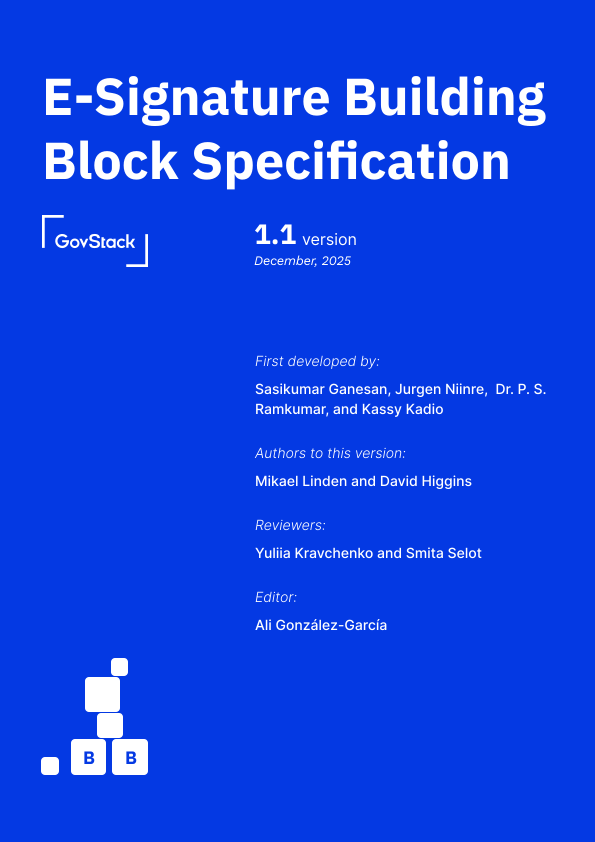

# E-Signature Building Block Specification

_**First developed by:**_ \
Sasikumar Ganesan, Jurgen Niinre,  Dr. P. S. Ramkumar, Kassy Kadio, in cooperation with GIZ, ITU, and DIAL.

***

_**Authors to this version:**_\
David Higgins and Mikael Linden

_**Contributors:**_ Charity Chirowamhangu, Antony Muriithi, Daniel Abadie, Norbert Nahayo, Rounak Nayak, Eric Ramirez, and Mary Metias

_**Reviewers:**_\
Yuliia Kravchenko and Smita Selot

_**Editor:**_\
Ali González-García

<figure><figcaption>
e-Signature cover
</figcaption></figure>
